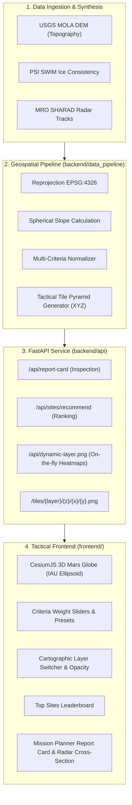

# AREOSITE: Mars Base Suitability & Uncertainty Engine

[](https://github.com/OdaloV/AREOSITE/tree/dev)
[](https://fastapi.tiangolo.com/)
[](https://reactjs.org/)
[](https://cesium.com/platform/cesiumjs/)
[](https://tailwindcss.com/)
[](https://pytest.org/)

**AREOSITE** is a real-time spatial decision support system for human Mars base siting. It fuses planetary elevation models (MOLA DEM), subsurface water-ice radar consistency datasets (PSI SWIM), and orbital sounder observation tracks (MRO SHARAD) into a high-performance multi-criteria suitability engine and interactive 3D tactical mission control interface.

---

## Table of Contents
1. [Scientific Foundation & Mission Criteria](#scientific-foundation--mission-criteria)
2. [System Architecture](#system-architecture)
3. [Branching & Git Workflow](#branching--git-workflow)
4. [Quickstart: Fullstack Development](#quickstart-fullstack-development)
5. [Data Pipeline & Tiler](#data-pipeline--tiler)
6. [Frontend Tactical Mission Control HUD](#frontend-tactical-mission-control-hud)
7. [API Specification & Examples](#api-specification--examples)
8. [Candidate Landing Sites Index](#candidate-landing-sites-index)
9. [Project Team & Collaborators](#project-team--collaborators)
10. [License](#license)

---

## Scientific Foundation & Mission Criteria

Selecting a landing zone for human exploration on Mars requires balancing resource accessibility against engineering constraints and orbital uncertainty:

```
                          ┌───────────────────────────┐
                          │ AREOSITE Siting Engine    │
                          └─────────────┬─────────────┘
                                        │
      ┌──────────────────┬──────────────┴─────┬──────────────────┐
      ▼                  ▼                    ▼                  ▼
┌───────────┐      ┌───────────┐        ┌───────────┐      ┌───────────┐
│ Water Ice │      │  Safety   │        │   Solar   │      │ Shielding │
│  (SWIM)   │      │  (MOLA)   │        │ (Flux/Lat)│      │  (EDL/CR) │
└───────────┘      └───────────┘        └───────────┘      └───────────┘
```

1. **Water Ice Accessibility (ISRU)**:
   - Evaluates shallow excess ice consistency from the Planetary Science Institute SWIM project.
   - Computes ice extraction feasibility based on dielectric interface depth (0.5m – 20m) and radar reflection consistency.
2. **Landing Safety (EDL & Terrain)**:
   - Analyzes topographic slope degrees derived from USGS MOLA elevation grids (demanding $\le 5^\circ$ for safe descent stage touchdown).
   - Penalizes high-altitude plateaus where thin Martian atmosphere reduces aerodynamic parachute braking efficiency (targeting $\le -1000\text{m}$ to $0\text{m}$ MOLA datum).
3. **Solar Power Generation**:
   - Models equatorial and sub-tropical solar insolation flux as a function of latitude and orbital obliquity, vital for photovoltaic arrays.
4. **Radiation Shielding**:
   - Leverages atmospheric column thickness (calculated from barometric pressure and elevation depth) combined with regolith and ground ice overburden to minimize galactic cosmic ray (GCR) and solar particle event (SPE) dosages.
5. **Observation Uncertainty & Radar Confidence (The Differentiator)**:
   - Measures observation track density from the Mars Reconnaissance Orbiter (MRO) Shallow Radar (SHARAD).
   - Calculates spatial confidence categories (`HIGH`, `MEDIUM`, `LOW`) and propagates error margins ($\pm \sigma$) to prevent false positives in landing site selection.

---

## System Architecture



---

## Branching & Git Workflow

The repository follows a clean branch integration strategy:

| Branch | Description | Status |
|---|---|---|
| **`main`** | Stable release branch | Production Ready |
| **`dev`** | Primary unified development branch combining frontend and backend | **Active / Default Integration** |
| **`backend`** | Core data ingestion, numerical scoring, and FastAPI endpoints | 35 commits |
| **`frontend`** | Tactical CesiumJS 3D HUD, React components, and styling | 30 commits across 5 contributors |

---

## Quickstart: Fullstack Development

### Prerequisites
- Python 3.10+
- Node.js 18+ and npm
- GDAL / NumPy compatible environment

### 1. Backend Engine Setup
```bash
# 1. Clone and enter the repository
git clone https://github.com/OdaloV/AREOSITE.git
cd AREOSITE
git checkout dev

# 2. Set up Python virtual environment
python3 -m venv .venv
source .venv/bin/activate

# 3. Install backend dependencies
pip install -r requirements.txt

# 4. Run the end-to-end data pipeline
python -m backend.data_pipeline.run_pipeline

# 5. Verify backend with automated tests
pytest -v

# 6. Launch FastAPI server (Port 8000)
uvicorn backend.api.app:app --host 0.0.0.0 --port 8000 --reload
```

### 2. Frontend Mission Control Setup
```bash
# In a new terminal tab:
cd AREOSITE/frontend

# 1. Install frontend packages
npm install

# 2. Run local development server (Port 3000)
npm run dev -- --host --port 3000
```
Open **`http://localhost:3000`** in any modern web browser with WebGL support.

---

## Data Pipeline & Tiler

The data pipeline can be executed as a unified CLI:

```bash
python -m backend.data_pipeline.run_pipeline
```

### Pipeline Deliverables:
- **`data/layers/*.tif`**: Single-band and multi-band GeoTIFF rasters reprojected to the Mars IAU 2000 Sphere (`EPSG:4326`).
- **`data/tiles/{layer}/{z}/{x}/{y}.png`**: Multi-resolution TMS/XYZ map tile pyramids (Zoom levels 0 through 2) rendered with tactical colormaps:
  - `human_base`: Balanced criteria suitability heatmap
  - `uncertainty`: SHARAD radar track density gaps
  - `confidence`: Tri-state sensor error qualification
  - `ice` / `power` / `safety` / `radiation`: Individual thematic layers

---

## Frontend Tactical Mission Control HUD

Built with **React 18**, **TypeScript**, **Tailwind CSS**, and **CesiumJS**:

- **Mars IAU Ellipsoid Model**: Configured using authentic Mars dimensions (semi-major axis: `3,396,190m`, semi-minor axis: `3,376,200m`) and Viking Color MDIM 2.1 global imagery.
- **Mission Criteria Sliders**: Real-time interactive weight tuning with dynamic normalized percentage distribution bars.
- **Mission Presets**: One-click configuration for standard mission profiles:
  - *Ice First*: Prioritizes ISRU subsurface water extraction.
  - *EDL Safety*: Maximizes low slope landing margins and atmospheric depth.
  - *Solar Outpost*: Prioritizes low-latitude equatorial photovoltaic flux.
  - *Deep Shielding*: Targets maximum radiation mitigation.
  - *Balanced Recon*: Equal distribution across all primary criteria.
- **Dynamic Layer Controls**: Live opacity blending and colormap toggles between suitability heatmaps, radar uncertainty, and water-ice maps.
- **Interactive Coordinate Inspection**: Click anywhere on the Martian surface to sample criteria scores, confidence intervals, and local geographic features.
- **Subsurface Stratum Diagram**: Visual cross-section showing estimated regolith overburden, dielectric boundary, and shallow excess ice depth with radar error bars ($\pm \sigma$).
- **Top Landing Sites Drawer**: Ranked leaderboard with instant orbital fly-to animation.

---

## API Specification & Examples

### Health Check
```http
GET /api/health
```
```json
{
  "status": "healthy",
  "engine": "AREOSITE v1.0.0",
  "data_layers_available": true,
  "supported_criteria": ["water_ice", "landing_safety", "solar_power", "radiation_shielding"]
}
```

### Coordinate Inspection (Report Card)
```http
GET /api/report-card?lat=39.2&lon=165.5&w_ice=0.4&w_safety=0.3&w_power=0.15&w_rad=0.15
```
```json
{
  "latitude": 39.2,
  "longitude": 165.5,
  "overall_suitability_score": 84.7,
  "confidence_rating": "HIGH",
  "ice_depth_meters": 2.4,
  "ice_depth_error_margin": 0.6,
  "radar_passes_count": 14,
  "nearest_candidate": "Arcadia Planitia North",
  "distance_km": 12.8,
  "criteria_breakdown": {
    "water_ice": 92.0,
    "landing_safety": 85.0,
    "solar_power": 64.0,
    "radiation_shielding": 81.0
  }
}
```

### Ranked Site Recommendations
```http
POST /api/sites/recommend
Content-Type: application/json

{
  "weights": {
    "water_ice": 0.35,
    "landing_safety": 0.30,
    "solar_power": 0.20,
    "radiation_shielding": 0.15
  },
  "top_n": 5
}
```

---

## Candidate Landing Sites Index

AREOSITE includes high-resolution ground truth anchors for 10 prime candidate landing sites on Mars:

| Site Name | Latitude | Longitude | Primary Advantage |
|---|---|---|---|
| **Arcadia Planitia North** | $39.2^\circ\text{N}$ | $189.7^\circ\text{E}$ | Widespread shallow sheet ice ($<2.5\text{m}$ depth) & flat terrain |
| **Arcadia Planitia Central** | $35.0^\circ\text{N}$ | $192.5^\circ\text{E}$ | Optimum balance between ISRU ice and EDL safety |
| **Erebus Montes** | $36.1^\circ\text{N}$ | $175.2^\circ\text{E}$ | Subsurface glacier lobate debris aprons |
| **Utopia Planitia** | $44.5^\circ\text{N}$ | $112.3^\circ\text{E}$ | Massive subsurface ice reservoir verified by SHARAD |
| **Deuteronilus Mensae** | $43.8^\circ\text{N}$ | $23.1^\circ\text{E}$ | High-purity ice cores protected by thin regolith cover |
| **Phlegra Dorsa** | $31.8^\circ\text{N}$ | $171.4^\circ\text{E}$ | Moderate latitude with enhanced solar energy potential |
| **Protonilus Mensae** | $42.2^\circ\text{N}$ | $47.5^\circ\text{E}$ | Subsurface glacial formations and natural terrain shielding |
| **Isidis Planitia** | $12.9^\circ\text{N}$ | $87.0^\circ\text{E}$ | Low elevation maximum atmospheric entry safety margin |
| **Jezero Crater Basin** | $18.4^\circ\text{N}$ | $77.5^\circ\text{E}$ | Rich astrobiological context and deltaic deposits |
| **Melas Chasma** | $-9.8^\circ\text{S}$ | $283.6^\circ\text{E}$ | Maximum atmospheric column density for radiation mitigation |

---

## Project Team & Collaborators

- **Lead Architect & Fullstack Development**: [@OdaloV](https://github.com/OdaloV)
- **Frontend & Cartography Collaborator**: [@Austinezeze7](https://github.com/Austinezeze7) (Austine Zeze Muyonga)
- **Geospatial & Visualization Collaborator**: [@kahenda](https://github.com/kahenda) (Philip Damwanza)
- **UI Components & Tooling Collaborator**: [@annanodiyo](https://github.com/annanodiyo)
- **Data Modeling & Presets Collaborator**: [@ibraah007](https://github.com/ibraah007)

---

## License

This project is licensed under the MIT License — see the [LICENSE](LICENSE) file for details.
